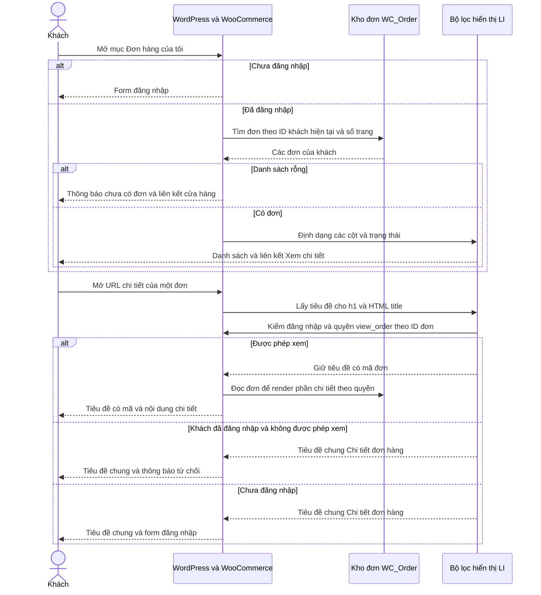

# Bàn giao T3-LI — Đơn hàng của tôi

## Phạm vi và trạng thái

T3-LI trình bày danh sách và chi tiết đơn của khách trong **Tài khoản → Đơn hàng của tôi**. WooCommerce lưu đơn, tính tiền và kiểm quyền. Checkout, thanh toán và tồn kho tiếp tục do WooCommerce và NL xử lý.

- [File LI](../wp-content/mu-plugins/mammart-account-orders.php) là MU plugin được WordPress tự nạp. Bước 3 nhận cả `sepay` và `mammart_sepay` khi đơn `on-hold`. Bước 5 bỏ hook LI chỉ dùng để in `h2` trùng với `h1` của theme. Bước 5B giới hạn mã đơn trong tiêu đề theo quyền `view_order` và hiện cột mã đơn trên màn hình nhỏ.
- Nền kiểm là `bf4e8c0` trên nhánh `t3-li/le-dinh-liem`, PHP 8.3.28, WordPress 7.1.4, WooCommerce 11.2.1 và theme `mammart-ui`. Site thử trên laptop dùng `http://127.0.0.1:8384/` và database riêng `mammart_t3_li_step2`. Probe HTTP xác nhận đường dẫn và mã băm của file LI được nạp.
- **T3-LI sẵn sàng review trong phạm vi đã kiểm.** Hai lỗi phát hiện ở Bước 5 đã đóng. Kết quả tích hợp PH và LO còn phụ thuộc vào đầu vào đơn WooCommerce.

## Dựng lại và kiểm lại

1. Tạo site WordPress thử trên một URL và database mới, riêng với môi trường đang dùng. Trỏ web root vào đúng worktree. Kiểm `git rev-parse --show-toplevel`, `git branch --show-current`, `git rev-parse HEAD`, `git status --short --branch` và `git diff`. Đối chiếu đường dẫn file LI nạp trong tiến trình web với worktree trước khi tạo dữ liệu.
2. Bật WooCommerce và plugin `mammart-provinces` từ nền Tuần 2. Tạo các trang WooCommerce mặc định nếu chưa có. Từ Git root, chạy `php Docs/T2-AL/setup_t2al.php` để dựng theme, slug và VND, rồi chạy `php Docs/T2-AL/seed_test_products.php` để nạp hàng thử. Bật permalink đẹp và xác nhận các trang Tài khoản, Giỏ hàng, Thanh toán truy cập được. [Hướng dẫn setup AL](T2-AL/README.md)
3. Trên site riêng, bật COD và SePay mô phỏng. Xếp vùng TP.HCM `VN:HCM` với phí 20.000 ₫ trước vùng Việt Nam `VN` với phí 30.000 ₫. Chặn email tại `pre_wp_mail`, chặn HTTP ra ngoài tại `pre_http_request` và chỉ dùng dữ liệu giả. Dựng dữ liệu mới từ các script đã nêu. [Cấu hình và bộ đơn giả lập NL](../T2-NL_README.md)
4. Tạo ba tài khoản Customer giả A, B và C, với C chưa có đơn. Cho A đặt COD có biến thể và nhiều dòng hàng qua Checkout Block. Tạo một đơn SePay có coupon WooCommerce cố định 15.000 ₫ và dùng [mô phỏng SePay của NL](../wp-content/plugins/mammart-provinces/sepay-simulator.php) để báo đủ tiền tại chỗ. Tạo thêm một đơn SePay mô phỏng rồi giữ ở `on-hold`. Dùng bộ sinh `mammart_seed_sample_orders_o1001_to_o1008()` qua PHP CLI với A là người dùng hiện tại để A sở hữu `O-1001` và `O-1003`. Tạo một đơn riêng cho B qua checkout hoặc `WC_Order` CRUD. Ghi lại mã đơn thực tế của mỗi lần dựng.
5. Mở phiên riêng A, B, C và một phiên chưa đăng nhập. Với A và B, đối chiếu danh sách, kể cả trang tiếp theo, và thử mở chi tiết đơn của mình. Thử mở một URL đơn demo của tài khoản kia và một ID đã xác nhận không có trong `WC_Order`. Với C, kiểm thông báo trống và liên kết **Mua sắm ngay**. Với khách vãng lai, kiểm form đăng nhập ở cả danh sách và URL chi tiết. Đối chiếu `h1` và `<title>` riêng với nội dung chi tiết cho từng vai trò.
6. So dữ liệu hiển thị với WooCommerce Admin hoặc PHP CLI `wc_get_order( $id )`. Trên trình duyệt, kiểm danh sách có đơn, chi tiết và danh sách trống ở desktop và khoảng 390 px. Ghi nhận mã đơn có nhìn thấy, bảng có tràn ngang và nút có thao tác được. Chạy `php -l wp-content/mu-plugins/mammart-account-orders.php` và `git diff --check`.

## Đối chiếu trường hiển thị với WC_Order

| Trường | Màn hình | Nguồn và cách đọc |
|---|---|---|
| Chủ đơn | Quyền hiển thị | WooCommerce lọc danh sách theo người dùng hiện tại và đối chiếu `get_user_id()` của đơn khi kiểm quyền `view_order`. |
| Mã đơn | Danh sách, chi tiết, tiêu đề của chủ đơn | `get_order_number()`. WooCommerce dùng ID đơn để lập URL chi tiết. Bộ mẫu NL có mã hiển thị riêng, ví dụ `O-1003 (#55)`. LI chỉ giữ mã trên `h1` và `<title>` của chi tiết khi quyền `view_order` được xác nhận. |
| Ngày đặt | Danh sách, chi tiết | `get_date_created()` qua `wc_format_datetime()`. |
| Trạng thái thanh toán | Danh sách, chi tiết | `get_meta( '_mammart_payment_status' )`. Nếu meta chưa tồn tại, LI xét đơn COD `completed` hoặc `get_date_paid()` với phương thức khác. Trạng thái ngoài ánh xạ hiện **Chưa xác định**. |
| Trạng thái xử lý | Danh sách, chi tiết | `get_status()` và `get_payment_method()` trong hàm dùng chung. `on-hold` với `cod` hiện **Chờ xác nhận**, với `sepay` hoặc `mammart_sepay` hiện **Chờ thanh toán**. |
| Sản phẩm, biến thể, số lượng | Chi tiết | WooCommerce render dòng từ `get_items()`, dùng tên dòng, metadata biến thể lưu trên đơn và `get_quantity()`. Đối chiếu kỹ biến thể bằng `get_variation_id()` trên dòng đơn. |
| Thành tiền dòng | Chi tiết | Template dùng `get_formatted_line_subtotal( $item )`, tức tiền dòng trước khoản giảm ở cấp đơn trong các ca demo. |
| Tiền hàng | Chi tiết | Dòng `cart_subtotal` trong `get_order_item_totals()`. Đối chiếu `get_subtotal()` trên bộ demo không thuế. |
| Giảm giá | Chi tiết | Dòng `discount`, bổ sung giá trị từ `get_discount_to_display()` khi thiếu. Đối chiếu `get_discount_total()` và `get_coupon_codes()`. |
| Phí giao | Chi tiết | Dòng `shipping`, bổ sung từ `get_shipping_to_display()` khi thiếu. Đối chiếu `get_shipping_total()`. |
| Tổng tiền | Danh sách, chi tiết | Danh sách dùng `get_formatted_order_total()`. Chi tiết dùng dòng `order_total`. Đối chiếu giá trị gốc từ `get_total()`. |
| Phương thức thanh toán | Chi tiết | Dòng `payment_method` hoặc `get_payment_method_title()` khi cần bổ sung nhãn. |

## Use case Xem đơn

- **Tác nhân** là khách mua hàng. Khách đã đăng nhập chọn **Tài khoản → Đơn hàng của tôi**.
- **Luồng chính** là xem danh sách theo từng trang, nhận biết mã đơn, ngày, số tiền và hai trạng thái, rồi chọn **Xem chi tiết**. Máy chủ kiểm quyền trước khi trả phần chi tiết. Trang đơn cho xem các dòng sản phẩm và tổng tiền đã lưu.
- **Luồng thay thế** gồm tài khoản chưa có đơn được mời tới cửa hàng, người không sở hữu hoặc mở đơn không tồn tại thấy thông báo từ chối, và khách chưa đăng nhập gặp form đăng nhập. Các lượt mở chi tiết bị chặn có tiêu đề chung **Chi tiết đơn hàng**.
- **Kết quả** là khách đọc được dữ liệu đơn do WooCommerce lưu. Việc xem không cập nhật đơn.

### Bảng quyền

| Phiên | Danh sách | `h1` và `<title>` của chi tiết | Nội dung khi mở chi tiết |
|---|---|---|---|
| Chủ đơn đã đăng nhập | Chỉ đơn của chính mình | Có mã hiển thị đúng của đơn | Có bảng chi tiết và tóm tắt trạng thái. |
| Khách đã đăng nhập nhưng không sở hữu đơn đang mở | Chỉ đơn của chính mình | **Chi tiết đơn hàng** | WooCommerce từ chối `view_order` và hiện `Invalid order.` |
| Khách đã đăng nhập, ID đơn không tồn tại | Chỉ đơn của chính mình | **Chi tiết đơn hàng** | WooCommerce hiện `Invalid order.` |
| Khách chưa đăng nhập | Form đăng nhập | **Chi tiết đơn hàng** với cả ID có thật và ID không tồn tại | Form đăng nhập. |

## Kết quả Bước 2–5B

| Bước | Ca | Cách kiểm | Kết quả |
|---|---|---|---|
| 2 | COD `#51` và SePay `#52` qua Checkout Block | HTTP Store API để đặt đơn, CLI `WC_Order` để đọc nguồn và mô phỏng đủ tiền, HTTP để đọc danh sách và chi tiết | COD có biến thể và hai dòng. SePay có giảm 15.000 ₫ và đổi sang `Paid` / `confirmed` sau mô phỏng. Hai đơn khớp nguồn trong các trạng thái đã kiểm. |
| 2 | Bộ mẫu `O-1001` đến `O-1008` | CLI tạo và đọc `WC_Order`, HTTP xem hai màn hình | Bảy đơn khớp. `O-1003` (`#55`) hiện **Chưa xác định** thay vì **Chờ thanh toán** do LI chưa xử lý mã `sepay`. |
| 3 | Ánh xạ sau sửa | HTTP danh sách và chi tiết, CLI `WC_Order`, PHP lint và `git diff --check` | `#55` sửa đúng, `#53` vẫn **Chờ xác nhận**, `#52` giữ `Paid` / `confirmed`. Tạo `#61` qua HTTP và giữ `on-hold` để kiểm `mammart_sepay`. Phương thức lạ thử bằng `WC_Order` trong bộ nhớ vẫn hiện **Chưa xác định**. |
| 4 | A, B, C và khách vãng lai, `#51`, `#52`, `#53`, `#55`, `#61` | Bốn phiên HTTP riêng, CLI đọc `WC_Order`, trình duyệt desktop kiểm B `#62` và C | Các trường và phần chi tiết khớp ở những ca đã kiểm. Danh sách có đơn và danh sách trống đều có tiêu đề lặp do LI thêm `h2`. |
| 5 | Danh sách B `#62`, chi tiết và danh sách trống C | Trình duyệt, viewport 1280 × 720 và 390 × 844 | Hai danh sách chỉ còn một `h1`. B mở được chi tiết ở hai kích thước. C thấy thông báo trống và mở được cửa hàng ở 390 px. Bảng nằm trong khung, nhưng mã đơn bị ẩn ở 390 px. |
| 5 | `#55`, `#61`, `#53` và hồi quy quyền | HTTP danh sách và chi tiết, CLI `WC_Order`, PHP lint và `git diff --check` | `#55` và `#61` hiện **Chưa thanh toán / Chờ thanh toán**. `#53` hiện **Chưa thanh toán / Chờ xác nhận**. Danh sách A và B chỉ chứa đơn của mình. Mở chéo bị chặn phần chi tiết, khách vãng lai gặp form đăng nhập. Kiểm riêng phát hiện mã mẫu trong tiêu đề của trang bị chặn. Lint và kiểm diff đều đạt. |
| 5B | Tiêu đề theo quyền và phần chi tiết | HTTP với A, B, khách vãng lai và ID `999999` được xác nhận không tồn tại bằng CLI `WC_Order` | 7/7 đạt. Chủ `#55` và `#62` giữ đúng mã trong `h1` và `<title>` và thấy chi tiết. Hai lượt mở chéo, khách vãng lai và hai lượt mở ID không tồn tại có tiêu đề chung. Không có bảng chi tiết, dữ liệu khách hoặc tóm tắt trạng thái trong những lượt bị chặn. WooCommerce vẫn hiện thông báo từ chối hoặc form đăng nhập theo phiên. |
| 5B | Danh sách B `#62` và chi tiết `#62` | Trình duyệt, 1280 × 720 và 390 × 844 | Ở cả hai khung, thấy mã `#62` và mở được chi tiết bằng nút **Xem chi tiết**. Danh sách chỉ có một `h1`, bảng danh sách và bảng chi tiết vừa khung. Desktop giữ ô mã đơn dạng cột, mobile hiện mã cùng nhãn **Mã đơn**. |
| 5B | Danh sách trống C | Trình duyệt, 1280 × 720 và 390 × 844 | Ở cả hai khung có một `h1`, thông báo **Bạn chưa có đơn hàng nào** và liên kết **Mua sắm ngay** mở đúng cửa hàng. Trang vừa khung. |
| 5B | Hồi quy trạng thái, tiền và quyền | HTTP danh sách và chi tiết, CLI `WC_Order`, PHP lint và `git diff --check` | `#55` và `#61` vẫn **Chưa thanh toán / Chờ thanh toán**, `#53` vẫn **Chưa thanh toán / Chờ xác nhận**. Sáu đơn đối chiếu `#51`, `#52`, `#53`, `#55`, `#61`, `#62` khớp nguồn. Kiểm lại danh sách theo chủ đơn, phiên vãng lai và tài khoản trống đều đạt. Lint và kiểm diff đạt. |

Bằng chứng lưu dưới `Temp` của người dùng Windows, ngoài web root. Thư mục `MamMart-T3-LI-Step5-evidence` giữ kết quả Bước 5 và `history-b2-b4.json` của các bước trước. Thư mục `MamMart-T3-LI-Step5B-evidence` chứa `http-wc-orders.json`, `view-order-title-access.json`, `browser-layout.json`, `verification.json` và sáu ảnh `desktop-*` và `390-*` của danh sách, chi tiết và trạng thái trống. Ảnh chi tiết được cắt trước vùng thông tin người mua. Giữ tài khoản, cookie, mật khẩu, dump và cấu hình site thử ngoài phạm vi Git.

## Hai lỗi đóng ở Bước 5B

- **Mã đơn trên màn hình nhỏ.** Template WooCommerce đặt mã trong `<th scope="row">` và CSS màn hình nhỏ ẩn ô này. LI thêm CSS theo breakpoint của WooCommerce, giới hạn ở ô mã đơn của bảng danh sách để khôi phục mã và nhãn **Mã đơn**. [Template danh sách](../wp-content/plugins/woocommerce/templates/myaccount/orders.php#L46) · [CSS WooCommerce](../wp-content/plugins/woocommerce/assets/css/woocommerce-smallscreen.scss#L33)
- **Tiêu đề theo quyền.** Trước sửa, endpoint `view-order` trả tiêu đề có mã mẫu cho khách B và khách vãng lai dù phần chi tiết của `#55` bị chặn. LI dùng `woocommerce_endpoint_view-order_title` để kiểm đăng nhập và `view_order` trước khi giữ mã WooCommerce đưa vào tiêu đề. Hook dùng chung cho `h1` và `<title>`. Phần chi tiết tiếp tục do WooCommerce kiểm quyền. [Nguồn tiêu đề WooCommerce](../wp-content/plugins/woocommerce/includes/class-wc-query.php#L137)

## Việc còn mở

- **PH:** Coupon demo của `#52` xác nhận LI hiển thị đúng khoản giảm trên một đơn WooCommerce. Đầu vào Tuần 2 chưa có đơn WooCommerce liên kết với ưu đãi PH để kiểm tích hợp.
- **LO:** Đầu vào Tuần 2 chưa có đơn WooCommerce liên kết với kế hoạch nhắc mua LO để kiểm tích hợp.
